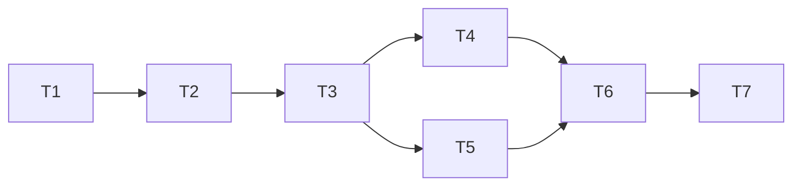

# 实施计划：可选模型组件（Model Packs）

- 规范依据：[SDD 25 · 可选模型组件](../sdd/feats/25-optional-model-packs/README.md)
- 上位约束：[SDD 24 §2](../sdd/feats/24-distribution-install/README.md)（重模型按需下载另立 SDD）、[SDD 19 §7.5](../sdd/feats/19-context-management/README.md)（工具分区，本次新增 D-12）
- 调研依据：本机实测 ONNX Runtime vs OpenVINO、INT8 负优化、四类模型 CPU 延迟（会话内 2026-10-28 基线）

## 0 目标与边界

达成：默认安装不含任何视觉权重；用户在上下文面板「工具」分区对声明了 `needs_pack` 的工具点安装，后端下载、校验、落盘，装完后该工具变为已挂载且能实际推理。

不做：断点续传、pack 多版本共存、自动更新、离线包导入、legacy 四个模型迁移、并行安装（SDD 25 §2）。

## 1 任务分解

### T1 · 清单与状态注册表（根任务）

- 写域：`backend/app/packs/catalog.json`、`backend/app/packs/__init__.py`、`backend/app/packs/registry.py`、`backend/app/config.py`
- 内容
  1. `catalog.json` 三项：`vision-runtime`(runtime) / `depth-dav2s`(model, depends vision-runtime) / `detect-rtdetr`(model, depends vision-runtime)，各含 id、type、display_name、license、bytes、sha256、urls、target_subdir
  2. `registry.py`：加载与校验清单（`sha256` 缺失、model 缺 `depends_on`、`depends_on` 非 runtime 一律抛错）、状态推导（五态）、僵尸态收敛、依赖就绪判定、`packs_root()` 路径
  3. `config.py` 新增 `PACKS_CATALOG`、`PACKS_ROOT`、`PACK_PROXY`、`PACK_MIRROR`
- 验收：清单缺字段时启动即抛错；`installing` 且 pid 不存在时推导为 `failed: interrupted`；单测覆盖六种状态推导
- 依赖：无

### T2 · 安装子进程

- 写域：`backend/app/packs/installer.py`
- 内容：独立可执行入口（`python -m app.packs.installer <id>`），五阶段 `resolving/downloading/verifying/installing/finalizing`；流式下载 + 边下边算 sha256；`.partial` 原子落盘；磁盘预检 ×1.2；代理与镜像前缀；tarfile `filter="data"`；每阶段写 `.progress.json`，完成写 `.state.json`
- 验收：sha256 不匹配时置 `failed: checksum_mismatch` 且不生成 pack 目录；磁盘不足不发起下载；路径穿越条目被拒绝；单测用本地 mock HTTP 服务，不依赖外网
- 依赖：T1

### T3 · 端点与守卫

- 写域：`backend/app/routers/packs.py`、`backend/app/main.py`
- 内容：五个端点（GET /packs、POST install、POST cancel、DELETE、GET progress）；回环守卫；全局串行队列；spawn 安装子进程（`sys.executable` + `-m app.packs.installer`），退出后回收状态
- 验收：幂等（ready 返回 200 不重下；installing 返回同一任务）；卸载被依赖运行时返回 409 `pack_in_use`；非回环来源 403；集成测试覆盖五个端点
- 依赖：T1、T2

### T4 · agent-runtime 挂载接线

- 写域：`agent-runtime/src/plugins/registry.ts`（及 `pi/` 侧挂载判定）、`agent-runtime/src/resources/load.ts`
- 内容：工具声明支持 `needs_pack`；组装挂载状态时查 backend `GET /packs`（TTL 缓存，失败即视为未就绪但不阻塞其他工具）；`unmounted.reason = needs_pack` 并附 pack id；`/resources` 工具目录透出 `needs_pack`
- 验收：pack 未装时该工具 `unmounted` 且 `reason=needs_pack`；backend 不可达时不影响其余工具挂载；单测覆盖
- 依赖：T3（需要端点存在；可先按契约 mock）

### T5 · 前端工具分区安装交互

- 写域：`frontend/src/components/context/`（工具分区）、`frontend/src/data/`（pack 客户端）、`frontend/src/i18n/{zh,en}.ts`
- 内容：`needs_pack` 工具行渲染安装/取消/卸载与进度条；500ms 轮询至终态；失败显示原因与重试；legacy「模型未就绪」与 pack 未安装文案分离（不同 i18n key）
- 验收：组件测试覆盖五态渲染；未声明 `needs_pack` 的工具无安装入口；装完后无需刷新即变为已挂载
- 依赖：T4（原因字段）、T3（端点）

### T6 · 端到端真机验收

- 写域：无（验证）
- 内容：本机安装 `vision-runtime` + `depth-dav2s`，跑一次 Depth Anything V2-Small 推理；记录实际耗时与调研基线（OpenVINO FP32 513–785ms）对比
- 验收：SDD 25 §15.6 通过
- 依赖：T3、T5

### T7 · 文档同步

- 写域：`docs/architecture.zh-CN.md`、`docs/sdd/feats/25-optional-model-packs/README.md`（状态）、`docs/sdd/README.md`、可选 `docs/runbooks/`
- 内容：仓库骨架总览补 `backend/app/packs/` 与 `~/glaux_models/packs/`；SDD 25 状态 `ready → implemented`；索引同步
- 验收：活文档与代码一致；无残留 `draft`
- 依赖：T6

## 2 执行顺序

T4 与 T5 可并行；其余串行。T6 前必须 T3 与 T5 完成（T4 与 T6 的关系是验收需要挂载状态可见）。

## 3 风险与回滚

| 风险 | 处置 |
| --- | --- |
| HF 权重 URL 变更导致 sha256 失效 | sha256 与 bytes 在实现时从实际下载计算；变更时只需改 `catalog.json` |
| 下载在 fake-ip 代理下失败 | `GLAUX_PACK_PROXY` 必测；安装器显式读环境变量，并有失败态 |
| 新增端点破坏既有回环/令牌行为 | 复用 `routers/loopback.py` 与 `LocalAccessMiddleware`，不改其实现；新增端点单测断言 403 |
| runtime 查 backend 失败拖慢工具组装 | TTL 缓存 + 请求超时；失败降级为「未就绪」，不抛错 |
| 前端轮询在终态未停 | 终态判定放轮询回调内，组件测试断言停止调用 |

回滚：本计划全部为新增文件与三处增量修改（`config.py`、`main.py`、`registry.ts`），回滚即撤销新增目录与这三处改动；安装产物在 `GLAUX_MODELS_ROOT/packs/`，删除不影响既有模型。

## 4 执行结果

（实施完成后回填）
