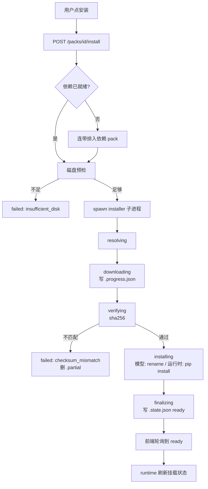
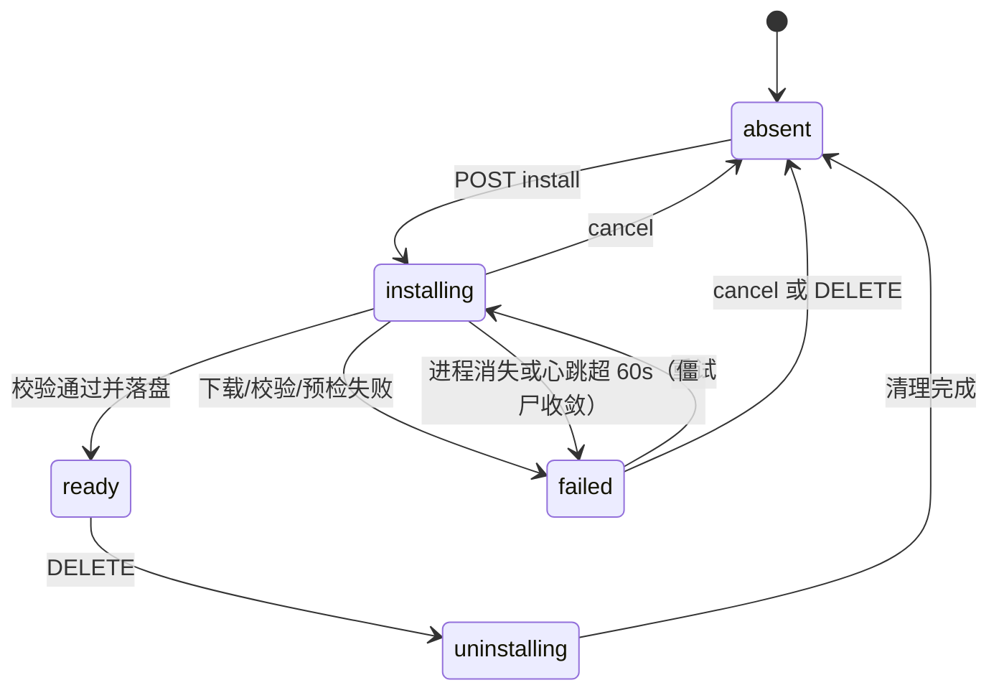

# 25 · 可选模型组件（Model Packs）

## 0. 文档状态

| 字段 | 内容 |
| --- | --- |
| 状态 | `ready` |
| 当前阶段 | 规范冻结，待实现。落地首个 pack 组合：`vision-runtime` + `depth-dav2s` + `detect-rtdetr` |
| 来源 | 2026-10-28 维护者提出：视觉模型默认不随安装包分发，用户在工具界面按需选装；并明确该机制须为后续所有可选能力铺路。承接 SDD 24 §2「重模型按需下载另立 SDD」 |
| 关联主 SDD | [Glaux SDD 索引](../../README.md) · [SDD 24 完整版分发与一键安装](../24-distribution-install/README.md) · [SDD 15 插件契约与权限引擎](../15-agent-plugins-permissions/README.md) · [SDD 19 上下文管理](../19-context-management/README.md) · [SDD 02 智能体图像标注能力](../02-agent-image-annotation/README.md) |
| 负责人 | Glaux 项目维护者 |
| 最后更新 | 2026-10-28 |

> 状态合法值仅四个：`draft` → `ready` → `implemented` → `accepted`。

## 1. 本 SDD 负责什么

让视觉效果模型不进入默认安装，由用户在工具界面按需安装、卸载，并让未安装状态以「工具未挂载」的形式如实呈现。冻结七件事：

1. **Pack 概念与内置清单**：一个可选组件是一个 pack，类型分 `runtime` 与 `model`，清单内置在仓库。
2. **目录布局与状态真值**：pack 落在 `GLAUX_MODELS_ROOT/packs/<id>/`，状态以文件系统文件为准。
3. **安装执行形态**：backend 提供端点，实际下载与安装由独立子进程执行，主进程不承载重活。
4. **端点契约与进度**：清单、安装、取消、卸载、进度五个端点，进度走轮询。
5. **状态机与失败处理**：五态模型、僵尸态收敛、校验失败、磁盘预检、并发串行。
6. **与工具挂载的接线**：新增挂载条件 `needs_pack`，挂载判定归 agent-runtime。
7. **首期两个模型 pack 的取舍**：以两个模型验证「共享运行时」这一前提。

## 2. 本 SDD 不负责什么

- **断点续传**：失败即重试，不做分片状态与一致性判断。
- **pack 多版本共存**：同一 pack 只保留一版，升级即覆盖。
- **自动更新**：不检查远端是否有新版本。
- **离线包导入**：不提供从本地文件安装 pack 的入口（内网镜像靠 `GLAUX_PACK_MIRROR` 前缀替换解决）。
- **legacy 模型迁移**：`hc_seg`、`caroSegDeep`、`TotalSegmentator`、`wsi_seg` 维持现状，不进 catalog、不参与安装。迁移另立 SDD。
- **并行安装**：全局串行，同一时刻只有一个安装任务。
- **模型精度评测**：本 SDD 只保证「装上能跑」，不定义各模型的准确率门槛。
- **`dataset` / `tool` 类型 pack 的实现**：类型位预留，本期不实现。
- **许可声明文件的随包分发**：catalog 记录许可标识，不约束分发形态。

## 3. 当前阶段目标

- 默认安装完成后，`GET /packs` 全部返回 `absent`，工具界面可正常浏览并显示体积。
- 安装 `vision-runtime`（约 115MB）与 `depth-dav2s`（约 99MB）后，深度工具从「未挂载：需要深度模型」变为「已挂载」，能实际跑出一次深度估计。
- 断网、下载中断、校验不匹配、磁盘不足四种情况都落到 `failed` 并给出可读原因，且不产生半装目录。
- 卸载被依赖的运行时返回 409 并说明被谁依赖。

## 4. 输入来源

### 4.1 用户操作

- 在上下文面板「工具」分区，对声明了 `needs_pack` 的未挂载工具点「安装」。
- 安装中可「取消」；已安装可「卸载」。

### 4.2 环境变量

| 变量 | 缺省 | 含义 |
| --- | --- | --- |
| `GLAUX_MODELS_ROOT` | `~/glaux_models` | 既有变量，pack 落在其下 `packs/` |
| `GLAUX_PACKS_CATALOG` | `backend/app/packs/catalog.json` | 清单文件路径，测试与内网可覆盖 |
| `GLAUX_PACK_PROXY` | 空 | 下载代理；空时回落 `HTTPS_PROXY` / `HTTP_PROXY` |
| `GLAUX_PACK_MIRROR` | 空 | 非空时替换 catalog 中 URL 的源前缀，供内网镜像 |

### 4.3 内置清单

`backend/app/packs/catalog.json` 随仓库分发，是 pack 的唯一定义来源。

## 5. 输出结果

### 5.1 用户可见输出

- 「工具」分区内每个 pack 的状态：`absent` / `installing`（含百分比）/ `ready` / `failed`（含原因）/ `uninstalling`。
- 安装完成后该工具行从「未挂载：需要 <pack 名称>」变为「已挂载」。

### 5.2 系统输出

- 目录 `GLAUX_MODELS_ROOT/packs/<id>/`，内含 `.state.json`、`.progress.json`（安装期）、运行时装在 `.venv/`，模型装权重文件。
- 端点响应结构见 §9.4。

## 6. 核心流程



## 7. 核心规则

### 7.1 Pack 类型与清单

1. 每个 pack 有稳定 `id`（kebab-case）、`type`、`display_name`、`description`、`license`、`bytes`、`sha256`、`urls`。
2. `type=runtime` 的 pack 提供一个可复用的 Python 环境；`type=model` 的 pack 提供权重与配置，必须声明 `depends_on`（指向一个 runtime）。
3. `depends_on` 只允许指向 `type=runtime` 的 pack，不支持多级依赖链。
4. 首期清单固定三项：

   | id | type | depends_on | 内容 | 体积 |
   | --- | --- | --- | --- | --- |
   | `vision-runtime` | runtime | — | onnxruntime + openvino + opencv-python-headless | 约 115MB |
   | `depth-dav2s` | model | `vision-runtime` | Depth Anything V2-Small ONNX（FP32）+ preprocessor 配置 | 约 99MB |
   | `detect-rtdetr` | model | `vision-runtime` | RT-DETRv2 R18 ONNX + 配置 | 约 81MB |

5. 清单中的 `sha256` 由实现时计算并写入；不允许留空。模型许可证一律 Apache-2.0，与仓库一致。

### 7.2 目录布局

```
GLAUX_MODELS_ROOT/packs/
    vision-runtime/
        .state.json
        .progress.json        # 仅安装期存在
        .venv/
    depth-dav2s/
        .state.json
        model_fp32.onnx
        preprocessor_config.json
```

1. 每个 pack 一个顶层目录，目录名等于 `id`。
2. 下载中的临时文件为同级的 `<id>.partial`（不进入 pack 目录），避免半装目录被误判为已装。

### 7.3 状态模型

对外只有五态：`absent`、`installing`、`ready`、`failed`、`uninstalling`。

1. **状态真值以文件系统为准**：`.state.json` 不存在且目录不存在即 `absent`；`.state.json` 的 `status` 字段为其余四态的依据。
2. `.state.json` 只补充 `is_file()` 表达不了的内容：`status`、`pack_version`、`installed_at`、`verified_sha256`、`error`、`pid`、`heartbeat_at`。
3. **僵尸态收敛**：`status=installing` 但 `pid` 对应进程不存在或 `heartbeat_at` 距今超过 60 秒，一律改判 `failed`，`error` 置 `interrupted`。该检查在 backend 启动时与每次 `GET /packs` 时执行。
4. 只有 `.state.json` 为 `ready` 且关键文件齐全（runtime 为 `.venv/bin/python`，model 为至少一个权重文件）时，才向工具挂载暴露为可用。二者不一致时按 `failed` 处理并写明 `error=incomplete`。

### 7.4 安装阶段

固定阶段序列：`resolving → downloading → verifying → installing → finalizing`。

1. `resolving`：解析依赖、检查父目录可写、磁盘预检。
2. `downloading`：流式下载全部 `urls`，边下边算 sha256，按累计字节写 `.progress.json`。
3. `verifying`：与清单 `sha256` 比对。
4. `installing`：`model` 为解压并移到 pack 目录；`runtime` 为用 `uv pip install` 建 `.venv`。
5. `finalizing`：写 `.state.json`，删除 `.progress.json` 与 `.partial`。

任一阶段失败即写 `failed` 并保留 `phase` 与 `error`。

### 7.5 校验、磁盘与源

1. **sha256 边下边算**，不通过则删除 `.partial`、置 `failed: checksum_mismatch`，不生成 pack 目录。
2. **原子落盘**：校验通过后才把临时产物移动到 `<id>/`，避免半装被当成已装。
3. **磁盘预检**：可用空间须 ≥ `bytes × 1.2`，不足时置 `failed: insufficient_disk` 且不启动下载。
4. **源**：`urls` 只允许 `https`。`GLAUX_PACK_MIRROR` 非空时替换 URL 的 scheme+host 前缀。
5. **代理**：`GLAUX_PACK_PROXY` 优先，其次 `HTTPS_PROXY`/`HTTP_PROXY`。**该变量不是可选项**：本机在 fake-ip 代理下 DNS 返回保留段地址，缺失代理配置将无法完成下载。

### 7.6 端点

全部挂在 backend，走与其他本机管理端点一致的回环守卫。

| 方法 | 路径 | 行为 |
| --- | --- | --- |
| GET | `/packs` | 返回清单与每项状态、依赖是否满足、体积 |
| POST | `/packs/{id}/install` | 202；已在装则幂等返回当前任务；依赖未就绪时连带排队 |
| POST | `/packs/{id}/cancel` | 终止子进程，删 `.partial` 与 `.progress.json`，置 `absent` |
| DELETE | `/packs/{id}` | 202；被其他 `ready` pack 依赖时返回 409 `pack_in_use` |
| GET | `/packs/{id}/progress` | 读 `.progress.json`；无进度文件时返回状态摘要 |

### 7.7 进度与轮询

1. 前端每 500ms 轮询 `GET /packs/{id}/progress`，`ready`/`failed`/`absent` 时停止轮询。
2. 不使用 SSE：backend 无 SSE 基础设施，安装为低频长任务，500ms 延迟可接受。
3. `.progress.json` 由安装子进程写，backend 只读，进程重启不丢进度。

### 7.8 与工具挂载的接线

1. `ToolProvider` 的挂载条件新增声明 `needs_pack: "<id>"`。只有声明了该条件的工具才在界面显示安装入口。
2. **挂载判定归 agent-runtime**：runtime 以短 TTL 缓存调用 backend `GET /packs`，在组装工具时判定 `needs_pack`，未满足时 `unmounted` 的 `reason` 为 `needs_pack`，并附 pack id。
3. 挂载状态仍只来自预览，与真实命令的工具集一致（沿用 SDD 19 D-6）。
4. **安装动作不经 runtime**：前端直接调 backend 端点，runtime 不参与安装。
5. 未挂载原因文案由前端 i18n 按 pack id 取（键 `needs_pack_<id>`），缺键时回落通用文案并显示 pack 名称。

### 7.9 与 legacy 模型的关系

1. `hc_seg`、`caroSegDeep`、`TotalSegmentator`、`wsi_seg` 维持现有 `config.py` 路径 + `*_available()` 三文件探测，不进 catalog、不显示安装入口。
2. 二者在界面上必须可区分：pack 的未安装提示文案与 legacy 模型的「模型未就绪」提示不得复用同一 key，避免被理解为同一件事。
3. legacy 的可用性判定逻辑本次不改动。

### 7.10 并发

1. 全局串行：同一时刻只允许一个安装任务，后来的请求排队并返回同一队列位置信息。
2. 串行理由：共享 runtime 可能被多个 model 同时依赖，并行会并发写同一 `.venv`。

## 8. 涉及对象

### 8.1 backend（新增）

- `app/packs/catalog.json`：内置清单。
- `app/packs/registry.py`：清单加载、状态推导、僵尸态收敛、依赖判定。
- `app/packs/installer.py`：**安装子进程入口**，独立执行，不被主进程 import 执行重活。
- `app/routers/packs.py`：五个端点。
- `app/config.py`：新增 `PACKS_CATALOG`、`PACK_PROXY`、`PACK_MIRROR` 三项。

### 8.2 agent-runtime（改动）

- 插件工具声明支持 `needs_pack`。
- 组装挂载状态时查 pack 可用性（带 TTL 缓存），产出 `reason=needs_pack`。
- `GET /resources` 的工具目录增加 `needs_pack` 字段透出。

### 8.3 前端（改动）

- 上下文面板「工具」分区：对 `needs_pack` 工具渲染安装/取消/卸载与进度。
- 新增 pack 状态查询与轮询逻辑。
- 新增 i18n 键：`needs_pack_<id>`、pack 名称与说明、失败原因文案。

### 8.4 新增文件

- `docs/sdd/feats/25-optional-model-packs/README.md`（本文件）
- `docs/plans/2026-10-28-001-feat-optional-model-packs-plan.zh-CN.md`（实现计划）

## 9. 数据或字段要求

### 9.1 `catalog.json`

```json
{
  "packs": [
    {
      "id": "vision-runtime",
      "type": "runtime",
      "depends_on": null,
      "display_name": "视觉运行时",
      "description": "onnxruntime + openvino + opencv 的共享环境，供所有 ONNX 视觉模型复用",
      "license": "Apache-2.0",
      "bytes": 120000000,
      "sha256": "<实现时计算>",
      "urls": ["https://..."],
      "target_subdir": ".venv"
    }
  ]
}
```

### 9.2 `.state.json`

```json
{
  "status": "ready",
  "pack_version": "1",
  "installed_at": "2026-10-28T07:20:00Z",
  "verified_sha256": "abc...",
  "error": null,
  "pid": 12345,
  "heartbeat_at": "2026-10-28T07:19:55Z"
}
```

### 9.3 `.progress.json`

```json
{
  "phase": "downloading",
  "bytes_done": 42000000,
  "bytes_total": 99060839,
  "updated_at": "2026-10-28T07:18:30Z",
  "error": null
}
```

### 9.4 `GET /packs` 响应

```json
{
  "packs": [
    {
      "id": "depth-dav2s",
      "type": "model",
      "depends_on": "vision-runtime",
      "display_name": "深度估计（DA2-Small）",
      "description": "...",
      "license": "Apache-2.0",
      "bytes": 99060839,
      "status": "absent",
      "dependency_ready": false,
      "error": null
    }
  ]
}
```

## 10. 幂等规则

1. `POST /packs/{id}/install` 对 `ready` 的 pack 返回 200 且不重复下载。
2. 对 `installing` 的 pack 重复调用返回 202 与同一任务信息，不启动第二个子进程。
3. 对 `failed` 的 pack 调用即重试：清理旧 `.partial` 与 `.state.json` 后重新走全流程。
4. `DELETE /packs/{id}` 对 `absent` 的 pack 返回 204，不报错。
5. 同一 pack 的 `cancel` 可重复调用，状态均落到 `absent`。

## 11. 状态或生命周期规则



1. 状态只经上述迁移，不允许跳变。
2. `ready` 是唯一向工具挂载暴露为可用的状态。
3. `uninstalling` 期间工具应视为不可用，避免运行中被删除运行时时取到半删状态。

## 12. 审计或事件规则

1. 安装、取消、卸载三个动作各写一条后端日志，含 pack id、触发来源（界面）、结果状态与耗时。
2. 不记录下载 URL 的查询参数，避免代理凭据进日志。
3. 不复用 agent-runtime 的会话审计记录：pack 管理不属于会话内工具调用。

## 13. 异常和人工处理

| 情况 | 表现 | 人工处理 |
| --- | --- | --- |
| 断网或代理不可达 | `failed: network_error`，保留 `.partial` 供重试 | 配好 `GLAUX_PACK_PROXY` 后重试 |
| sha256 不匹配 | `failed: checksum_mismatch`，删除 `.partial` | 重试；若持续失败说明镜像内容被改，需换源 |
| 磁盘不足 | `failed: insufficient_disk` | 清理后重试 |
| 安装进程崩溃 | 僵尸收敛为 `failed: interrupted` | 直接重试 |
| 卸载被依赖的运行时 | 409 `pack_in_use`，响应列出依赖方 | 先卸模型再卸运行时 |
| 清单损坏或缺失 | `GET /packs` 返回 500 并在日志写明解析错误；工具分区显示「组件清单不可用」 | 修复或覆盖 `GLAUX_PACKS_CATALOG` |

## 14. 与其他 SDD 的调用关系

| SDD | 关系 |
| --- | --- |
| [24 完整版分发与一键安装](../24-distribution-install/README.md) | 本 SDD 承接其 §2「重模型按需下载另立 SDD」；安装包仍不含任何权重。本 SDD 不改变安装脚本与包结构 |
| [15 插件契约与权限引擎](../15-agent-plugins-permissions/README.md) | 工具挂载条件新增 `needs_pack` 声明；挂载与否仍由插件条件与权限模式共同决定，`needs_pack` 是其中之一 |
| [19 上下文管理](../19-context-management/README.md) | **立场变更**：其 §1「工具分区只读」改为「工具定义只读，但可对声明了 pack 依赖的工具发起安装/卸载」。该 SDD 需同步修订并新增决策记录 |
| [02 智能体图像标注能力](../02-agent-image-annotation/README.md) | 不涉及。`locate_roi` 走模型连接，不经 pack |

## 15. 验收标准

### 15.1 清单与状态

- [ ] 默认状态下 `GET /packs` 返回三项，状态均为 `absent`，`dependency_ready` 如实反映。
- [ ] 清单缺失 `sha256` 或 `type=model` 未声明 `depends_on` 时，启动即报错，不静默降级。
- [ ] `status=installing` 且进程已死时，`GET /packs` 返回 `failed` 且 `error=interrupted`（单元测试）。

### 15.2 安装流程

- [ ] 安装 `vision-runtime` 走完五个阶段，最终 `.state.json` 为 `ready`，`.venv/bin/python` 可执行。
- [ ] 安装 `depth-dav2s` 时若运行时未装，连带排队并最终两者均 `ready`。
- [ ] sha256 不匹配时置 `failed: checksum_mismatch`，且 `packs/depth-dav2s/` 目录不存在（集成测试，mock HTTP）。
- [ ] 磁盘预检不足时置 `failed: insufficient_disk`，不发起任何下载（单元测试）。
- [ ] 取消进行中的安装后状态为 `absent`，`.partial` 与 `.progress.json` 均已删除。

### 15.3 卸载与依赖

- [ ] 卸载被 `ready` 模型依赖的 `vision-runtime` 返回 409 并列出依赖方。
- [ ] 卸载 `depth-dav2s` 后，深度工具回到「未挂载：需要深度模型」。

### 15.4 工具界面

- [ ] 未装 pack 时，该工具显示「未挂载：需要 <pack 名称>」与安装入口。
- [ ] 未声明 `needs_pack` 的工具不出现任何安装入口（组件测试）。
- [ ] 安装中显示百分比并随轮询更新，完成后无需刷新页面即变为已挂载。
- [ ] pack 未安装提示与 legacy 模型「模型未就绪」提示分别渲染，文案不共用 key。

### 15.5 安全

- [ ] 安装器拒绝清单之外的 URL（单元测试）。
- [ ] 解压时含 `../` 的条目被拒绝，不写到 pack 目录之外（单元测试）。
- [ ] pack 管理端点非回环来源返回 403。

### 15.6 端到端

- [ ] 真机（Intel Core Ultra 5 225H / CPU-only）安装 `vision-runtime` + `depth-dav2s`，跑一次 Depth Anything V2-Small 推理并出深度图，单张耗时与调研基线（OpenVINO FP32 513–785ms）同量级。

## 16. 决策记录

| 编号 | 决策 | 理由 |
| --- | --- | --- |
| D-1 | Pack 是最小可安装单元，分 `runtime` / `model` 两类 | 「共享运行时」要求依赖被多个模型复用，二者不能混为一个粒度 |
| D-2 | 首期只上 `vision-runtime` + 两个模型 | 单模型无法验证依赖复用与「运行时被卸载」行为；OCR 权重打包在 pip 包内，形态不同，留待二期 |
| D-3 | 后端端点 + 独立安装子进程，不做进程内异步下载 | 与仓库「重活不进主进程」取向一致；可取消、可恢复、失败不污染主服务 |
| D-4 | 状态与进度均以文件系统为准，不引入数据库或内存真值 | 安装跨进程跨重启；沿用既有 `is_file()` 探测惯例，不新增真值来源 |
| D-5 | 五态模型 + 僵尸态收敛 | 无收敛机制时一次断电会让 pack 永久卡在「安装中」 |
| D-6 | 进度用轮询（500ms），不用 SSE | backend 无 SSE 基础设施，低频长任务不值得新建事件通道 |
| D-7 | 不做断点续传 | 引入分片状态与一致性判断，复杂度不抵收益；失败重试即可 |
| D-8 | 全局串行安装 | 共享 runtime 可能被多个模型同时依赖，并行会并发写同一 `.venv` |
| D-9 | sha256 必填，缺失即启动报错 | 允许留空等于允许不校验，会让「装上但内容被改」成为静默失败 |
| D-10 | 临时产物放 `<id>.partial`，校验通过才移入 pack 目录 | 避免半装目录被 `is_file()` 误判为已装 |
| D-11 | 挂载判定归 agent-runtime，安装动作不经 runtime | 挂载状态必须与真实命令一致（SDD 19 D-6）；runtime 不是执行面 |
| D-12 | legacy 四个模型不迁移 | 迁移风险高于收益；但它们与 pack 的未就绪提示必须文案分离 |
| D-13 | 推翻 SDD 19「工具分区只读」 | 用户需求要求就地选装；只读视图无法承载安装动作。SDD 19 需同步修订 |
| D-14 | 只允许清单内 URL，且仅 https | 防 SSRF；复用既有 `net-guard` 判定思路 |
| D-15 | `GLAUX_PACK_PROXY` 为必备能力而非增强项 | 本机 fake-ip 代理环境下 DNS 返回保留段地址，无代理配置即无法判定可达性 |
| D-16 | 卸载被依赖的运行时返回 409 而非级联卸载 | 级联删除会隐式移除用户显式安装的模型，破坏可预期性 |

## 17. 待确认问题

无。范围、契约、状态机、错误处理与验收均已在 §1–§16 冻结。

以下为实现期需填写的具体值，不构成规范开放项：

- `catalog.json` 中各 pack 的真实 `sha256` 与字节数（下载后计算）。
- `vision-runtime` 的安装源（`uv pip install` 的索引与包版本锁定）。
- i18n 中各 pack 的中英文显示名与说明文案。
